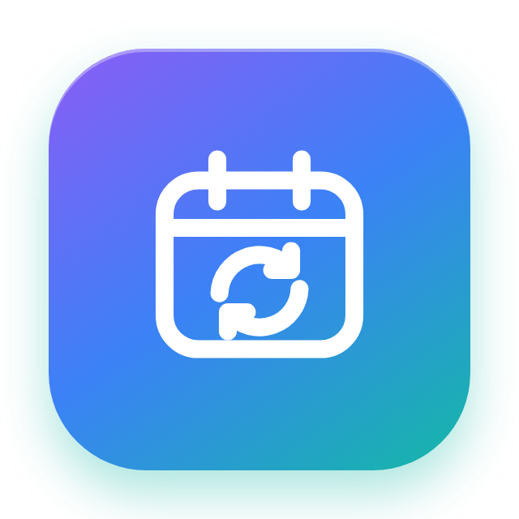
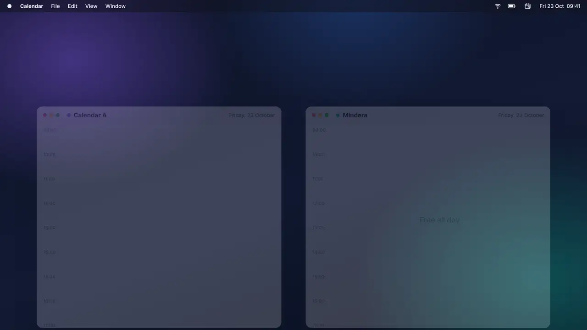
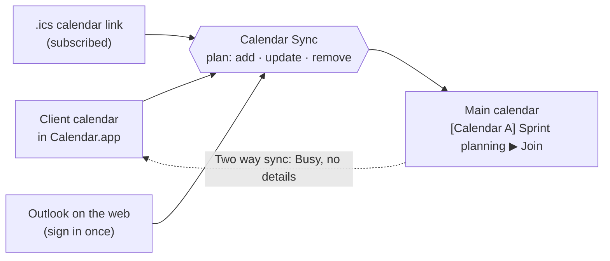

<div align="center">



# Calendar Sync

**Your client meetings, in your main calendar.**

A tiny macOS menu bar app that copies meetings from your client calendars into your main calendar, so colleagues stop booking you over your client standup.

[](Support/Info.plist)
[](https://github.com/neteinstein/Calendar-Sync/actions/workflows/build.yml)


[](https://github.com/neteinstein/homebrew-tap)
[](LICENSE.md)

<a href="https://github.com/neteinstein/Calendar-Sync/raw/main/docs/calendar-sync.mp4">
  
</a>

<sub>▶ <a href="https://github.com/neteinstein/Calendar-Sync/raw/main/docs/calendar-sync.mp4">Watch with sound</a> · 21 seconds</sub>

</div>

---

## Install

With [Homebrew](https://brew.sh/)

To install:
```bash
brew install neteinstein/tap/calendar-sync
```

To run, one time:
```bash
open "$(brew --prefix)/opt/calendar-sync/Calendar Sync.app"
```
or to always have it run at startup:
```bash
brew services start neteinstein/tap/calendar-sync 
```


The first time it runs, the app links itself into your own Applications folder (`~/Applications`), so Finder and the Dock can open it. The link follows upgrades.

Needs macOS 14+ and the Xcode command line tools. See [Get started](#get-started) for updating, building from source and first-run setup.

## Why

Booked solid at the client. Wide open in your main calendar.

When you work inside a client's calendar, your main calendar (the one your colleagues book you through) says you're free all day. The old fix was a [hand-built Shortcut and a cron job](#coming-from-the-shortcut). Calendar Sync does the same job properly: one install, a settings window, and copies that stay correct when meetings move.

## What you get

<table>
<tr>
<td width="50%" valign="top">

### 🏷️ Named by its calendar
Each copy is titled **`[Calendar name] Meeting name`**, e.g. `[Calendar A] Sprint planning`. For calendars in Calendar.app it uses the calendar's own name and picks up renames.

</td>
<td width="50%" valign="top">

### 🔗 Meeting link included
Teams, Zoom, Google Meet and Webex links are copied onto the event and shown first in its notes, so **Join** works straight from your main calendar.

</td>
</tr>
<tr>
<td valign="top">

### 🔁 Moved? It moves. Cancelled? It's gone.
Copies are matched to their original by a hidden tag, not by title and time. Moved meetings are updated, cancelled ones removed, and recurring meetings just work.

</td>
<td valign="top">

### 🌐 Even browser-only calendars
Client account can't be added to your Mac? Sign in to **Outlook on the web** inside the app once, or subscribe to a published **.ics** link.

</td>
</tr>
<tr>
<td valign="top">

### 🙈 Hide meeting names
Per calendar, copies can be titled `[Calendar A] Busy` instead. The meeting link still comes along.

</td>
<td valign="top">

### 🛡️ Safe by design
It never copies attendees, so no invites go out. It never copies its own copies back, so two-way setups don't loop. If a calendar can't be read, its copies are left alone.

</td>
</tr>
<tr>
<td colspan="2" valign="top">

### ↩️ Sync both ways
Optional, in the **Two way sync** tab. Your main calendar's events are added to your client calendars as plain **Busy** events — or **Out of office**, your pick per calendar — with the time and nothing else: no title, link, location or attendees. Their description is just “Busy”, so you can tell what was added automatically, and nothing in them names the app. Copies of a client's own meetings are skipped, and meetings copied from other clients do show, so each client sees the time the others have booked. It needs client calendars you can edit in Calendar.app; Outlook on the web and `.ics` link calendars are read-only.

</td>
</tr>
</table>

It also lets you **skip meetings you declined**, **skip all-day events** and **skip out-of-office events** (on by default). Per client calendar, copies can also get the meeting's **location and description**.

Never miss a start: turn on the optional **full-screen alert** and the screen is covered when a main-calendar meeting begins (or up to 15 minutes before), with buttons to **Join call** (⏎), **Go to** the room, or **Ignore** (⎋). Meetings copied from client calendars alert too, join link included, and each meeting alerts once.

Prefer the menu bar? Turn on **Show a calendar in the menu** and the icon gains **today's date** — add the **week day**, the **moon phase** and the **time** next to it if you like — while clicking it opens a **month view** (click a day for its events; start the week on **Sunday or Monday** and hide **weekends** if you like) or a **scrolling list** of your main calendar's events — it opens at the next event, and scrolling back shows past events dimmed. Events with a meeting link get a join button right in the list. The lists tint each event with the **color of the calendar it came from**, shade **all-day events**, and group each day's **morning** and **afternoon** into colored blocks — each of these can be turned off.

Settings also shows the app **version** and checks GitHub once a day for a newer one (the newest release, or the version on `main` while there are no releases). When there is one, a warning appears with an **Update** button that shows the pull-and-rebuild instructions.

It syncs **every 15 minutes** by default; set any interval from 1 minute to 24 hours, and give a client calendar **its own interval** when it should sync more or less often than the rest (say, Outlook on the web hourly). Calendar.app calendars also sync about 10 seconds after a change. Settings has a **preview** that shows what the next sync would change before it changes anything.

## How it works



Every copy ends its notes with a tag like `calsync:v1:<source id>:<occurrence id>`. The app uses it to recognise its own copies and match them to their originals, which is why a moved meeting gets updated instead of duplicated.

The Busy events that two way sync adds to client calendars carry no tag. The app recognises them by their title (**Busy** or **Out of office**), their description (just “Busy”) and having no attendees, and matches them to your main calendar by time. So in a client calendar that two way sync writes to, an event you make yourself that looks exactly like that is treated as one of them.

## Client calendars it can read

| Client calendar | How to add it |
|---|---|
| **Added to Calendar.app** (Exchange, Google, iCloud, …) | **Add client calendar › From Calendar.app** |
| **Browser only, with a published link** | **Add client calendar › Calendar link (.ics)**. Calendar.app subscribes to the link, then you pick it like any other calendar. |
| **Browser only: Outlook / Microsoft 365** | **Add client calendar › Outlook on the web**. Sign in once in the app's own window (MFA included, also with a USB security key). Each sync reloads Outlook's week view in the background, reads the meetings it loads, then loads each meeting in full for its join link and details. *Experimental.* |

<details>
<summary><b>About the Outlook on the web option</b></summary>

<br>

- It reads the same data your browser shows you. Nothing is sent anywhere except into your own calendar.
- To Outlook it is one more Safari signed in to the account: the app's window runs the WebKit of the Safari installed on your Mac and reports its user agent, with its own cookie store. Microsoft's sign-in logs show it as Safari on macOS, and the same sign-in policies apply as to a browser.
- **USB security keys (YubiKey and other FIDO2 keys) work in the window**: macOS only lets full browsers use them, so the app talks to the key itself, the way browsers do. When Microsoft asks for the key, the app asks for the key's PIN, then you touch the key. Only signing in works: register a new key in a browser. Passkeys on the Mac or a phone, and NFC keys, can't be used in the window. A company sign-in page that isn't Microsoft's (Okta, ADFS, …) doesn't offer the key in the window, so use another method there.
- It depends on how Outlook's web app works internally, which Microsoft can change without notice. If a sync can't find calendar data, or you've been signed out, the existing copies are **left as they are**. The menu bar icon then shows a warning and an **Open Outlook** button.
- Reading a client's calendar this way may go against the client's IT or security policy. **Check with the client first**, and consider turning on **Hide meeting names** for that calendar.
- Each Outlook calendar keeps its own sign-in, so you can add more than one.

</details>

## Get started

You need **macOS 14 or later** and **Xcode 15+** (the command line tools are enough).

### With [Homebrew](https://brew.sh)

Install with the two commands under [Install](#install). The formula lives in the [neteinstein/homebrew-tap](https://github.com/neteinstein/homebrew-tap) tap and builds the app from source on your Mac (that's why it needs the Xcode command line tools), so there's nothing to sign or notarize. `brew install --HEAD neteinstein/tap/calendar-sync` builds the latest `main` instead of the pinned version.

- **Updating:** `brew update && brew upgrade calendar-sync`. Settings also warns you when a newer version is out, and its **Update** button shows these commands. If the app is running, it keeps running the old version until you restart it, and `brew upgrade` prints how: `brew services restart calendar-sync` if you started it with `brew services`, otherwise `pkill -x CalendarSync; sleep 1; open "$(brew --prefix)/opt/calendar-sync/Calendar Sync.app"`. The pause lets the old copy quit first, since only one copy runs at a time.
- **Open at login:** run `brew services start calendar-sync` (the full name, `brew services start neteinstein/tap/calendar-sync`, works too) and leave **Open at login** in Settings off. Only one copy runs at a time, so a second login item would just start and quit. The service runs the app from Homebrew's `opt` path, so it keeps starting the newest version after upgrades. `brew upgrade` doesn't restart it: run `brew services restart calendar-sync` for that.
- **In your Applications folder:** the first time it runs from Homebrew, the app puts a link to itself in `~/Applications`, unless `/Applications` already has one. Homebrew can't do that at install time, and your desktop account may not be allowed to write to `/Applications`, but it always owns `~/Applications`. The link goes through Homebrew's `opt` path, so it opens the newest version after upgrades. Finder and the Dock treat the link as the app; Spotlight and Launchpad don't list linked apps. Remove the link and it stays removed. Want it in `/Applications` instead? From an account that can write there, run `ln -s "$(brew --prefix)/opt/calendar-sync/Calendar Sync.app" /Applications/`. `brew uninstall` leaves the link behind: remove it with `rm ~/Applications/"Calendar Sync.app"` (or `/Applications/"Calendar Sync.app"`).
- **Homebrew in a separate admin account:** install and upgrade from the admin account as usual, but run `brew services` from the account you log in to the desktop with. The admin account has no desktop session to start the app in, so there it fails with `Domain does not support specified action`. If your own account then refuses to load the formula from an untrusted tap, run `brew trust --formula neteinstein/tap/calendar-sync` from it first. Don't start the app by hand from the admin account either (the hint `brew services` prints after a failure suggests it): that copy runs in the admin account, not in your desktop session, so it logs `Connection interrupted` errors and keeps running until you stop it with Ctrl-C or `pkill CalendarSync`.
- Upgrades are ad-hoc signed builds, so macOS asks for calendar access again after each one. Your settings are kept.

### From source

```bash
git clone https://github.com/neteinstein/Calendar-Sync
cd Calendar-Sync
scripts/build-app.sh
open "build/Calendar Sync.app"
```

To update later: quit the app, then `git pull && scripts/build-app.sh` and reopen it.

Allow calendar access on first launch. Then open **Settings…** from the menu bar icon:

1. **General:** choose your **main calendar** (the one meetings are copied into), how many days ahead, and how often to sync. Turn on the **full-screen alert** here if you want one when each meeting starts.
2. **Client(s) to Main Calendar:** add each client calendar. For Outlook on the web, also give it a calendar name. Optionally turn on **Copy location and description** or **Use its own sync interval**.
3. **Two way sync:** turn on **Sync both ways** to show your main calendar as **Busy** in your client calendars, so they all show the same booked time. Turning it on includes every client calendar you can edit; turn off **Show my main calendar here** for any that shouldn't, or pick **Out of office** instead of **Busy**.
4. **Preview:** see what a sync would change, then let it run.

> [!NOTE]
> Local builds are ad-hoc signed, so macOS asks for calendar access again after each rebuild.

## Development

```bash
swift test
```

The tests cover the sync rules: titles, meeting links, details, moves, deletes, filters, no loops, per-calendar intervals, and the Outlook data parser. They run on Linux too. CI builds the app and runs the tests on macOS for every push.

| Folder | What's in it |
|---|---|
| [`Sources/CalendarSyncCore`](Sources/CalendarSyncCore) | Platform-independent rules: `SyncPlanner` (what to add, update and remove), `SyncSchedule` (which calendars are due), `CopyFormatter` (titles and notes), `MeetingLink`, `CopyMarker`, `HTMLText` and `OutlookWebParser` |
| [`Sources/CalendarSync`](Sources/CalendarSync) | The macOS app: `EventKitBridge` (Calendar.app), `OutlookWebSource` (built-in Outlook browser), `SyncController` (scheduling) and the SwiftUI views |
| [`Tests`](Tests) | Unit tests for the core |
| [`scripts/build-app.sh`](scripts/build-app.sh) | Builds and signs `Calendar Sync.app` |

### Known limits

- Calendar.app refreshes accounts every few minutes, so changes made on the client side show up with that delay.
- If you remove a client calendar from the app, the copies already made from it stay in your calendar, and the Busy events two way sync added to it stay in the client calendar. Delete them in Calendar if you no longer want them. To have the app take the Busy events back, turn off **Show my main calendar here** (or **Sync both ways**) and let it sync before removing the calendar.


## License

Calendar Sync is source-available under the [Sustainable Use License 1.0](LICENSE.md) (SPDX `SUL-1.0`). You can use and change it for free, for personal use or at work, **including commercially** for your own business. You can share it, with or without your changes, as long as you do so for free and for noncommercial purposes. Selling it, building a product or service from it, or including it in one needs a separate licence from the author.

Copyright (c) 2026 Pedro Vicente (https://github.com/neteinstein)

<div align="center">
<br>
<sub>Demo video made with <a href="https://github.com/latent-spaces/brag">/brag</a>.</sub>
</div>
